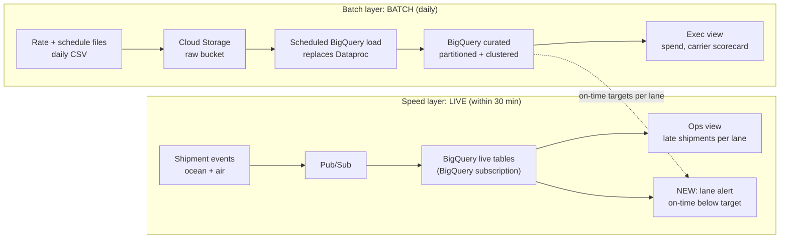

# Platform architecture: Coastline Fashion (SHP06)

Adapted from the reference platform in `architecture/`. Targets: freshness 30 minutes,
reliability 60% ocean / 90% air per lane, budget $25 per month.

## Live or batch

| Box | Live or batch | Why |
|---|---|---|
| Shipment events, Pub/Sub, BigQuery live, Ops view | **Live** | The ops team must see a slipping vessel or flight within the 30-minute freshness target. |
| Lane alert (new) | **Live** | Flags a lane as soon as its on-time rate drops below 60% (ocean) or 90% (air). SGSIN → BEANR already fails (50%). |
| Rate and schedule files, Cloud Storage, BigQuery curated, Exec view | **Batch** | Carriers send these once a day, and carrier choice and spend are reviewed weekly, not by the minute. |

## Changes from the reference

- **Crossed out: Kafka on GKE.** Pub/Sub alone handles our event volume, and a GKE cluster running all month would use up most of the $25 budget.
- **Crossed out: Dataflow (streaming).** A Pub/Sub BigQuery subscription writes events straight into BigQuery without an always-on worker. 30 minutes of freshness doesn't need per-second processing.
- **Crossed out: Dataproc.** About 2 MB of CSV per month doesn't need a Spark cluster; a scheduled BigQuery load does the same job for free.
- **Added: lane alert.** Coastline Fashion's reliability target is per lane, so the platform should flag a failing lane instead of waiting for someone to check a dashboard.
